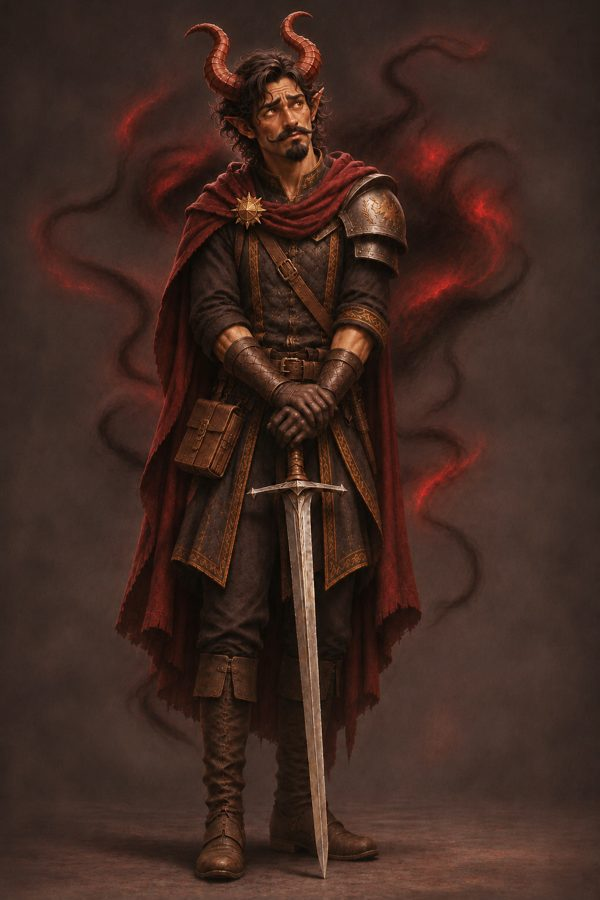

{: .portrait }

# Malverio dalle Poche Certezze

> *Tiefling — Warlock (Hexblade) 10, Ufficiale della Guardia di Neverwinter*

---

## Aspetto

Malverio è un tiefling dall'aspetto distinto, o quantomeno così ama definirsi. Due imponenti corna ricurve incorniciano un volto dai lineamenti affilati, sovrastato da una chioma scura e irrimediabilmente disordinata. Un pizzetto e un paio di baffi accuratamente curati tradiscono una certa attenzione alla propria immagine.

Indossa un'elegante armatura scura, accompagnata da un vistoso mantello rosso, che porta con la naturalezza di chi ritiene che ogni ingresso meriti una certa solennità.

Al suo fianco riposa inseparabilmente **Appendice**, una spada alla quale Malverio si rivolge spesso come a una vecchia conoscenza. Se questa gli risponda davvero, nessuno è ancora riuscito a stabilirlo.

---

## Personalità

Malverio è un individuo di straordinaria sicurezza, incrollabile dignità e conoscenze piuttosto discutibili.

Dotato di grande carisma e di una parlantina inesauribile, affronta ogni situazione con l'atteggiamento di chi possiede tutte le risposte, anche quando non ha compreso bene la domanda.

È particolarmente incline a dispensare consigli non richiesti, formulare deduzioni improbabili e sostenere le proprie conclusioni con una convinzione tale da mettere in difficoltà persino chi conosce la verità.

Il suo celebre appellativo, «dalle Poche Certezze», non deriva da un'indole dubbiosa. Al contrario: Malverio possiede effettivamente poche certezze, ma le considera assolute, indipendentemente dalla loro fondatezza.

Dietro l'atteggiamento pomposo e una vanità difficilmente contenibile, si nasconde tuttavia un individuo profondamente leale, coraggioso e sinceramente affezionato ai propri compagni.

---

## Storia

Dopo aver condiviso numerose avventure con un improbabile gruppo di compagni, Malverio ha trascorso gli ultimi due anni a **Neverwinter**, entrando nei ranghi della Guardia Cittadina e riuscendo, non senza una certa soddisfazione personale, a ottenere il grado di **ufficiale**.

Un incarico che ha preso estremamente sul serio.

Tra turni di pattuglia, questioni amministrative, disordini nei quartieri cittadini e una quantità apparentemente inesauribile di problemi disciplinari, Malverio si è convinto di essere diventato uno dei pilastri fondamentali della sicurezza di Neverwinter.

Quanto questa convinzione sia condivisa dai suoi superiori rimane una questione aperta.

Nonostante la carriera militare, Malverio non ha mai dimenticato i suoi vecchi compagni d'avventura: **Karesh, Kobrut, Asha e Astorio**.

Il loro ritorno a Neverwinter rappresenta per lui una gioia autentica, oltre che, a suo giudizio, una provvidenziale soluzione alla cronica carenza di personale della Guardia Cittadina.

---

## Appendice, la sua spada

Nessuna descrizione di Malverio sarebbe completa senza menzionare la sua inseparabile spada.

Malverio conversa abitualmente con **Appendice**, talvolta chiedendole consiglio, altre volte discutendo apertamente con lei o rispondendo a osservazioni che nessun altro sembra aver udito.

Chi lo conosce da tempo ha imparato a non farci troppo caso.

La natura del legame tra il tiefling e la sua arma rimane sconosciuta. Quel che è certo è che, nonostante una corporatura tutt'altro che possente, Malverio dimostra in combattimento una capacità sorprendente, accompagnata da manifestazioni di una magia oscura e inquietante.

Se sia Malverio a brandire Appendice o, in qualche modo, il contrario, è una domanda alla quale nessuno ha ancora trovato risposta.

---

## Informazioni Base

| | |
|---|---|
| **Nome completo** | Malverio dalle Poche Certezze |
| **Razza** | Tiefling (Standard) |
| **Classe** | Warlock (Hexblade) 10 |
| **Background** | Charlatan |
| **Allineamento** | Chaotic Neutral |
| **Forza** | 5 (−3) |
| **Destrezza** | 13 (+1) |
| **Costituzione** | 14 (+2) |
| **Intelligenza** | 13 (+1) |
| **Saggezza** | 10 (+0) |
| **Carisma** | 20 (+5) |

---

## Statistiche

- **PF Massimi:** 73
- **CA:** 18 (Half Plate + Cloak of Protection)
- **Velocità:** 30ft
- **Iniziativa:** +1
- **Bonus di Competenza:** +4
- **Saggezza Passiva (Percezione):** 10

### Tiri Salvezza
| | |
|---|---|
| **Forza** | −2 |
| **Destrezza** | +2 |
| **Costituzione** | +7 |
| **Intelligenza** | +2 |
| **Saggezza** | +5 |
| **Carisma** | +10 |

### Abilità
Deception +9, Intimidire +5, Persuasione +5, Rapidità di Mano +5, Performance +5, Arcano +5, Investigazione +5, Furtività +1

### Linguaggi
Comune, Inferno

### Competenze
Armature: leggere, medie, scudi
Armi: marziali, semplici
Strumento: Disguise Kit, Forgery Kit

---

## Privilegi e Tratti

### Tratti Razziali (Tiefling — Infernal Legacy)
- **Hellish Resistance** — Resistenza ai danni da **fuoco**.
- **Darkvision** — Visione al buio 60ft.
- **Infernal Legacy** — Conosci il trucchetto *Thaumaturgy*. A 3° livello puoi lanciare *Hellish Rebuke* (2° livello) una volta per riposo lungo. Carisma è la tua abilità da incantatore.

### Warlock (Hexblade 10)
- **Hexblade's Curse** — Azione bonus: maledici una creatura entro 30ft per 1 minuto. +4 ai danni contro di essa, critico su 19–20, e recuperi PF pari a livello warlock + Carisma se muore. 1/riposo breve o lungo.
- **Hex Warrior** — Competenza con armature medie, scudi e armi marziali. Le tue armi usano **Carisma** per attacco e danno.
- **Eldritch Invocations**:
    - **Thirsting Blade** — Due attacchi con l'arma del patto.
    - **Improved Pact Weapon** — L'arma del patto è un focus da incantatore, +1 ad attacco e danno.
    - **Agonizing Blast** — Aggiungi Carisma ai danni di *Eldritch Blast*.
    - **Eldritch Mind** — Vantaggio sui TS Costituzione per mantenere la concentrazione.
    - **Eldritch Smite** — Spende uno slot per +1d8 danni da forza per livello dello slot e atterra il bersaglio (se Huge o più piccolo).
- **Pact of the Blade** — Crea l'arma del patto in mano; conta come magica per superare resistenze.
- **Accursed Specter** — Quando uccidi un umanoide, la sua anima può risorgere come uno spettro al tuo servizio fino al prossimo riposo lungo.
- **Armor of Hexes** — Se una creatura maledetta ti colpisce, reazione: tira 1d6; su 4+ l'attacco manca.
- **Eldritch Versatility** — Puoi scambiare cantrip e opzioni del patto ai livelli che concedono ASI.

### Talento
- **Resilient (Costituzione)** — +1 a Costituzione (max 20) e competenza nei tiri salvezza su Costituzione.

---

## Attacchi

| Arma | Bonus | Danno | Tipo |
|---|---|---|---|
| **Appendice (1-H)** | +10 | 1d8+6 | Tagliente |
| **Appendice (2-H)** | +10 | 1d10+6 | Tagliente |
| **Eldritch Blast** | +9 | 1d10+5 | Forza |
| **Eldritch Smite** | — | 6d8 (slot 3°–5°) | Forza |
| **Thunder Step** | CD 17 | 3d10 | Tuono |
| **Synaptic Static** | CD 17 | 8d6 | Psichico |
| **Hellish Rebuke** | CD 17 | 2d10 | Fuoco |

---

## Incantesimi (Warlock)

**CD Tiro Salvezza:** 17 | **Bonus Attacco:** +9 | **Slot:** 2 (5°, recupero a riposo breve/lungo) · **Mystic Arcanum:** 1 slot 5°

### Trucchetti
- **Thaumaturgy** — Effetti minori soprannaturali, voce amplificata, fiamme danzanti, porte che sbattono.
- **Mage Hand** — Mano spettrale che manipola oggetti entro 30ft.
- **Eldritch Blast** — Raggio di energia, 1d10 danni da forza (2 raggi).
- **Prestidigitation** — Trucchetti minori: pulire, sporcare, raffreddare, scaldare, piccoli suoni o luci.
- **Minor Illusion** — Suono o immagine di un oggetto entro 30ft.

### Livello 1
- **Armor of Agathys** — PF temporanei; chi ti colpisce in mischia subisce 5 danni da freddo.
- **Shield** — Reazione: +5 CA fino al tuo prossimo turno.
- **Hellish Rebuke** — Reazione: 2d10 danni da fuoco a chi ti ha danneggiato.

### Livello 2
- **Misty Step** — Azione bonus: teletrasporto di 30ft.
- **Darkness** — Oscurità magica 15ft di raggio.

### Livello 3
- **Counterspell** — Interrompe un incantesimo in lancio entro 60ft.
- **Dispel Magic** — Termina magie di 3° o inferiore; superiore richiede prova.
- **Thunder Step** — Teletrasporto + 3d10 danni da tuono intorno al punto di partenza.

### Livello 4
- **Banishment** — Manda una creatura in un'altra dimensione (TS Carisma).
- **Dimension Door** — Teletrasporto fino a 500ft con un compagno.
- **Shadow of Moil** — Oscurato pesantemente, resistenza al radiante, 2d8 necrotici a chi ti colpisce.

### Livello 5 (Mystic Arcanum)
- **Synaptic Static** — 8d6 danni psichici in sfera 20ft + TS Intelligenza; i bersagli che falliscono hanno svantaggio mentale per 1 minuto.

---

## Equipaggiamento

- Half Plate
- Cloak of Protection
- Appendice (spada del patto)
- Manacles
- Steel Mirror
- Perfume
- Backpack
- 3 Rations
- 1 Torch
- 1 Tinderbox
- 2 Potion of Healing (2d4+2)
- 2 Potion of Greater Healing (4d4+4)
- 1 Bedroll
- 95 CP · 140 GP · 1 PP

---

## Tratti Caratteriali

- «Sono un giocatore nato: non riesco a resistere a un rischio che promette un guadagno.»
- Porta con sé più simboli sacri e invoca qualunque divinità possa essergli utile al momento.

### Ideali
**Indipendenza** — Sono uno spirito libero: nessuno mi dice cosa fare. (Caotico)

### Legami
Ho truffato la persona sbagliata e devo fare in modo che non incroci mai più la mia strada, né quella di chi ho a cuore.

### Difetti
Sono convinto che nessuno potrebbe mai ingannarmi come io inganno gli altri.

---

> *«La differenza tra un uomo saggio e uno stolto non è il numero delle certezze che possiede, ma la fermezza con cui le sostiene.»*
> — Malverio dalle Poche Certezze, probabilmente.